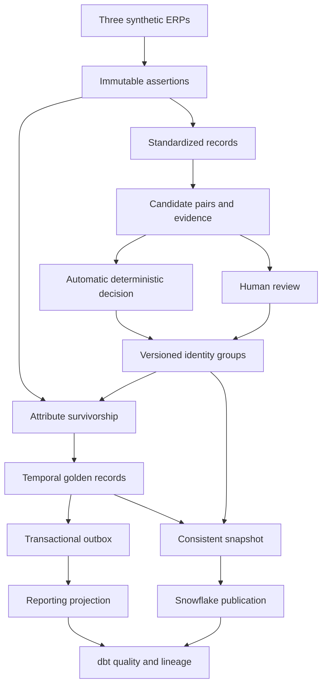

# Architecture and decision boundaries

This project consolidates identities from three fictional industrial ERPs. A
customer and a supplier can be roles of the same organization. A parent company,
its subsidiary, an establishment and a product remain different identities unless
the domain contract explicitly says otherwise.

PostgreSQL holds the operational decision ledger. Snowflake is the analytical
integration target. Both have dbt models and business invariant tests; executing
the PostgreSQL path does not qualify a Snowflake account, its privileges, its
warehouse performance or its consumption. See [the Snowflake contract](snowflake.md).

## Data and control flow

This diagram describes the implemented paths, not an assertion that every
external integration has run. The execution record and CI artifacts identify
which environments were exercised.

## Persistent layers

| Layer | Objects | Purpose |
| --- | --- | --- |
| Original assertions | `raw_records` | Append-only source payload, content hash, business start and observation time. Reingestion of the same assertion does not duplicate it. |
| Current source interpretation | `source_records`, `standard_records` | Composite source identity and current comparison projection, with revision and normalization version. |
| Matching evidence | `candidates` | Source revisions, rule version, mode, criterion contributions, conflicts and disposition. |
| Human and automatic decisions | `decisions`, `decision_events` | Versioned requests and immutable actor/transition audit events. |
| Identity membership | `identity_groups`, `memberships`, `membership_history` | Stable golden IDs, active/retired state, current crosswalk and knowledge history. |
| Golden values | `golden_history` | Attribute values and provenance over business validity and knowledge intervals. |
| Publication | `outbox` | Immutable, versioned changes committed with the decision. |
| Reference consumer | `consumer_inbox`, `consumer_records`, `consumer_crosswalk` | Idempotent event receipt, current reporting interpretation and source-to-golden references. |
| Orchestration | `runs`, `run_sources` | Input hash, phase, bounded attempts and per-source checkpoints. |
| Installation | `schema_migrations` | Applied migration version and checksum. An edited applied migration is rejected. |

Original input is distinct from its current interpretation. Raw rows, decision
events and outbox entries reject updates and deletes through database triggers.
The service closes previous temporal interpretations and writes corrections. It
does not rewrite the original assertion to make the latest decision appear older.

## Transaction boundaries

Each graph mutation takes the PostgreSQL transaction advisory lock
`24022002`. It checks the expected group and decision versions, checks the full
proposed group for hard contradictions, updates membership and temporal values,
and appends outbox events in one transaction. The scope is intentionally a single
writer for identity changes. This prevents incompatible concurrent graph edits;
it also limits write throughput. Adding API workers does not remove that limit.

Human requests have three different named actors: requester, approver and
executor. API roles come from server-side token configuration. Clients do not get
to assert their own role. Automatic merges are a separate, versioned deterministic
policy lane. Human approval cannot override a hard identity contradiction.

Golden history uses half-open business intervals `[valid_from, valid_to)` and
knowledge intervals `[known_from, known_to)`. A PostgreSQL trigger rejects an
overlap in both dimensions for one identity. A late assertion can change today's
understanding of a prior business interval while retaining the earlier
interpretation as knowledge history.

The outbox is committed before any consumer publication. A crash after a decision
commits therefore leaves a durable event to replay. The reference consumer records
receipt and updates its projection in one transaction; its `(consumer, event_id)`
key rejects duplicate receipt. A group correction publishes new versions. It does
not erase decisions already made in an ERP, invoice or payment system.

## One orchestrator

The Python application is the only orchestrator. `mdm run` performs ingestion,
reconciliation and reference-consumer publication. A PostgreSQL session advisory
lock `24022003` prevents concurrent orchestration runs. A crash releases that
session lock, while durable source checkpoints remain in the database.

A run key binds to the input manifest hash and matching mode. Reusing the same key
with changed input fails. A failed run can be resumed with its original manifest
and key, up to three attempts. Ingestion is content-idempotent, so a crash between
the source commit and its checkpoint can replay safely. Successful and degraded
runs return their stored result on retry. A recovered previously unavailable ERP
requires a new run key and an explicitly updated manifest.

No second scheduler, message broker or Kubernetes cluster is needed for this
reference deployment. A production scheduler may invoke the same bounded CLI,
but it must preserve its idempotency key and must not implement a competing
decision state machine.

## Contracts and safe configuration

Source inputs use a strict versioned schema. Identity keys retain the source,
domain and original source ID. Rules are reviewed Python and fixed SQL, documented
in the versioned rule contract. Metadata cannot provide arbitrary code, SQL,
table expressions or executable function names. Snowflake identifiers are
validated before interpolation; payload values use bound parameters.

The reference API exposes decisions, golden records, history, crosswalks, quality
and an authenticated metrics endpoint. `/healthz` reveals health status only. The
console keeps an operator token in page memory. It does not embed an administrative
token in the downloaded page or put tokens in URLs.

## Deployment scope and known limits

The Compose reference runs Linux containers on one host. It uses a persistent
PostgreSQL volume, a one-shot migration service and one API worker. PostgreSQL is
on an internal Docker network. The API is published only on `127.0.0.1:8000` by
default. Runtime secrets are supplied as files. CPU, memory, process count,
shutdown time and log growth are bounded in the Compose file.

The reference database account bootstraps the dedicated local instance; it is not
a production least-privilege role design. A target deployment needs separate
database ownership/migration, runtime, warehouse loader and read-only consumer
roles, external secret rotation, a TLS ingress if remote access is needed, and
tested off-host backup retention. These are deployment prerequisites, not evidence
already obtained by starting the local container.

Candidate pairs are materialized in memory. Dense blocks fail explicitly at the
configured limits instead of silently losing recall. The write lane is serialized
and historical rows grow with corrections. Benchmarks must report these costs,
the fixture size and candidate count. No distributed throughput claim follows
from this architecture.

## Decisions and operational references

- [ADR 001 — Transactional reference and analytical target](adr/001-control-plane-and-warehouse.md)
- [ADR 002 — Durable bounded orchestration](adr/002-durable-orchestration.md)
- [ADR 003 — Compensating corrections and consumers](adr/003-corrections-and-consumers.md)
- [Matching policy, truth set and measured denominators](matching.md)
- [Operations, incidents, backup and restore](operations.md)

PostgreSQL's transaction semantics, advisory locks and range operators are
documented in its [transaction isolation](https://www.postgresql.org/docs/17/transaction-iso.html),
[advisory locking](https://www.postgresql.org/docs/17/explicit-locking.html#ADVISORY-LOCKS)
and [range operator](https://www.postgresql.org/docs/17/functions-range.html) references.
Those capabilities explain the design; repository tests establish whether this
implementation preserves its intended invariants.
